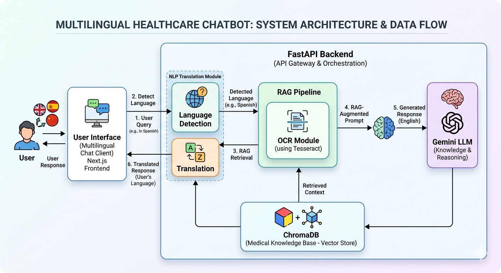
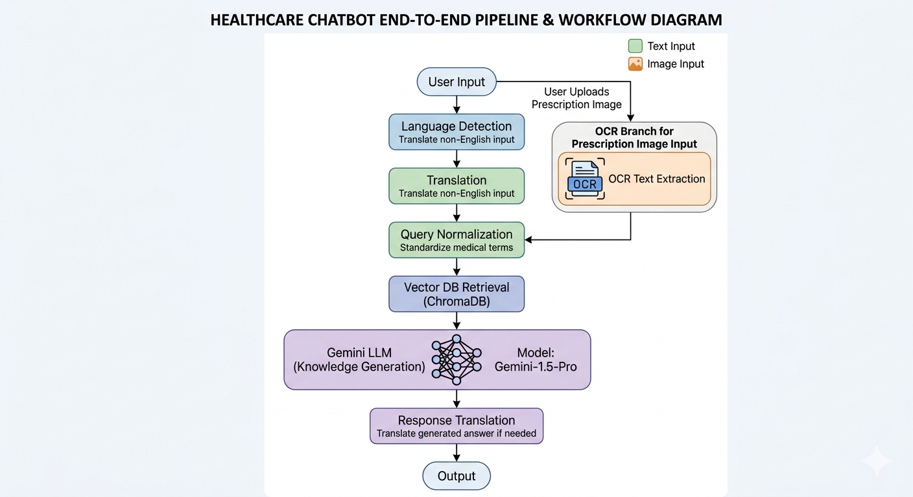
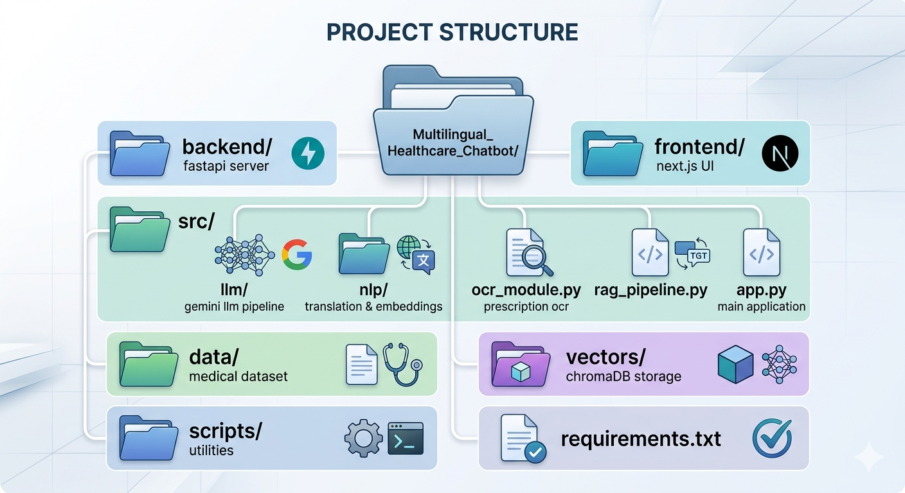
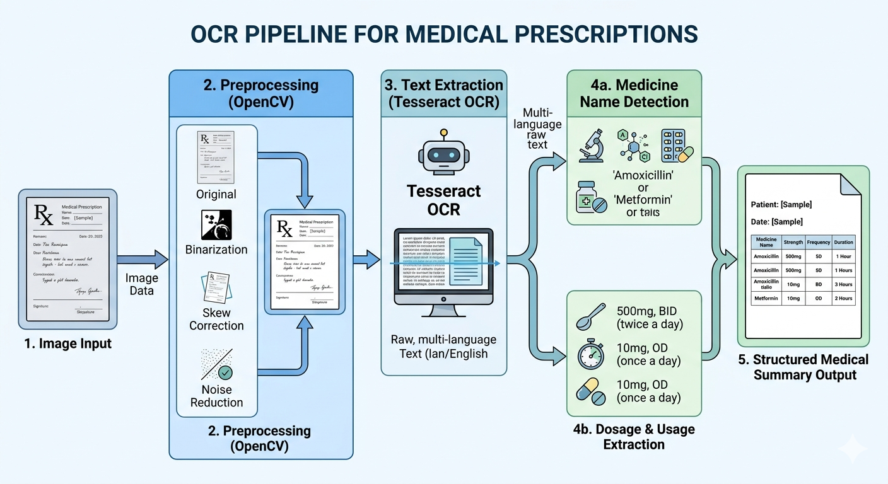

# 🏥 Multilingual Healthcare Chatbot

A **smart AI-powered healthcare chatbot** that supports **Urdu + English queries**, uses **LLM + RAG (Retrieval-Augmented Generation)**, and can even extract information from **prescription images using OCR**.

## 🧠 System Architecture

This project combines multiple AI technologies:

* 🧾 Retrieval-Augmented Generation (RAG)
* 🤖 Gemini LLM (medical response generation)
* 🌐 Multilingual NLP (Urdu ↔ English translation)
* 📄 OCR-based prescription understanding
* ⚡ FastAPI backend + Next.js frontend

## 🖼️ System Architecture Diagram



## ✨ Key Features

* 🌍 Multilingual support (Urdu + English)
* 🧠 AI medical response generation (Gemini LLM)
* 📚 RAG-based medical knowledge retrieval
* 🧾 Prescription image OCR extraction
* 🔤 Spell correction for medical terms
* ⚡ FastAPI backend for high performance
* 💬 Smart query understanding system

## 🔄 Workflow Diagram


## 📁 Project Structure

## 🧾 OCR Pipeline Example



```

## 🤖 Core Components

### 🧠 LLM Pipeline

* Detects language (Urdu/English)
* Normalizes medical spelling
* Retrieves context from vector DB
* Generates safe medical response using Gemini

### 🌐 Multilingual Module

* Language detection using `langdetect`
* Translation using `deep_translator`
* Embedding support for multilingual queries

### 🧾 OCR Module

* Image preprocessing (OpenCV)
* Text extraction (Tesseract)
* Medicine & dosage detection
* Structured output generation

### 📚 RAG System

* SentenceTransformer embeddings
* ChromaDB vector search
* Medical knowledge retrieval

## ⚙️ Setup Instructions

```bash
git clone https://github.com/your-repo.git
cd Multilingual_Healthcare_Chatbot
python -m venv env
env\Scripts\activate
pip install -r requirements.txt
```

## 🔑 Environment Setup

```env
GOOGLE_API_KEY=your_gemini_api_key
```

## ▶️ Run Project

### Backend

```bash
cd backend
python main.py
```

### Frontend

```bash
cd frontend
npm install
npm run dev
```

## 📊 API Endpoints

| Endpoint               | Description             |
| ---------------------- | ----------------------- |
| `/ask`                 | Ask medical question    |
| `/upload_prescription` | OCR prescription upload |
| `/`                    | Health check            |

## 🚀 Recommended Improvements

* Add authentication system 🔐
* Deploy backend on cloud (AWS / Render) ☁️
* Improve OCR accuracy with deep learning 📄
* Add voice-based medical assistant 🎤
* Add conversation memory 🧠

## ⚠️ Disclaimer

This system is for **educational and research purposes only**. It does not provide medical diagnosis.

## 🏁 Final Note

This project demonstrates:

* AI + Healthcare integration
* Multilingual NLP systems
* RAG-based intelligent retrieval
* OCR + real-world AI pipeline
